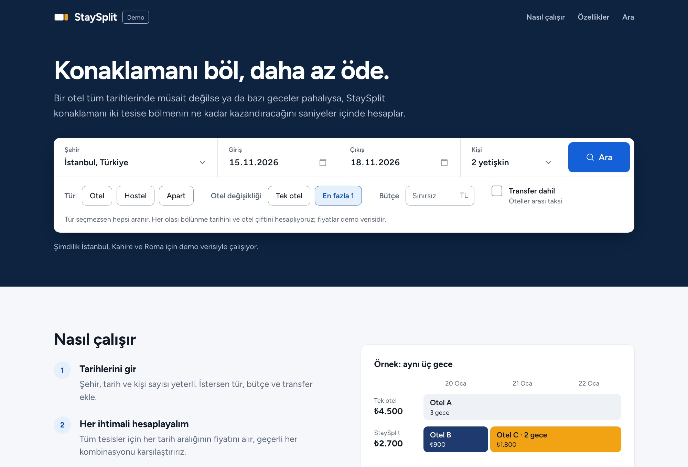
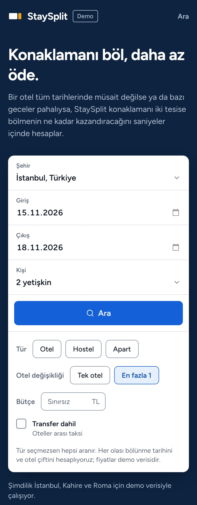
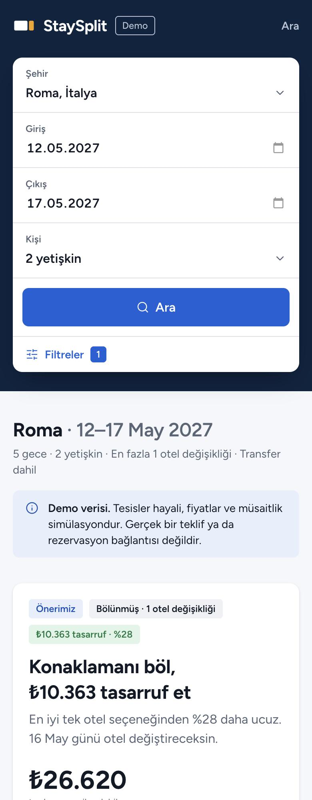

# StaySplit

**Konaklamanı böl, daha az öde.**

StaySplit, bir seyahatin gecelerini iki farklı tesise bölmenin, tek otelde kalmaya göre ne kadar
kazandıracağını hesaplayan bir konaklama planlayıcısı. Her olası değişiklik gününü ve her otel çiftini
tarar. Sonuçta toplam fiyatı, gerçek tasarrufu, kaç kez otel değiştireceğini ve isteğe bağlı tahmini
transfer maliyetini gösterir.



> [!NOTE]
> **Demo sürüm.** Tüm tesisler hayali, fiyatlar ve müsaitlik simülasyondur. StaySplit şu an hiçbir
> konaklama sağlayıcısına bağlı değildir; rezervasyon ya da ödeme almaz ve rezervasyon bağlantıları bilerek
> boş bırakılmıştır.

## Neyi çözüyor?

Otel fiyatları geceden geceye değişir ve bir otel her gece müsait olmayabilir. Booking.com gibi siteler ise
genellikle tüm tarihler için tek bir tesis arar. StaySplit konaklamayı ikiye bölmeyi de dener:

| Seçenek | Plan | Toplam |
| --- | --- | --- |
| Tek otel | Otel A · 20–23 Ocak | 4.500 TL |
| StaySplit | Otel B · 20–21 Ocak (900 TL) → Otel C · 21–23 Ocak (1.800 TL) | **2.700 TL** · 1.800 TL (%40) tasarruf |

20–22 + 22–23 gibi diğer bölünmeler de hesaplanır. Bölmek değmiyorsa (fark çok küçükse ya da transfer
maliyeti tasarrufu siliyorsa) StaySplit bunu açıkça söyler ve tek otelde kalmanı önerir.

## Ekran görüntüleri


<p align="center">
  
  &nbsp;&nbsp;
  
</p>

## Özellikler

- **Kesin optimizasyon:** Her bölünme tarihi ve her otel çifti dinamik programlamayla değerlendirilir. Doğruluk,
  rastgele örneklerde tüm planları tek tek deneyen brute-force ile karşılaştırılarak test edilir.
- **Gerçek toplam fiyat:** Gecelik fiyatlar toplanmaz. Uzun konaklama indirimi, temizlik ücreti ve vergiler
  dahil, tesisin o tarih aralığı için verdiği teklif kullanılır.
- **Dürüst öneri:** Tasarruf %5'in altındaysa, fiyat eşitse ya da transfer maliyeti farkı kapatıyorsa tek otel
  önerilir ve nedeni gösterilir.
- **Transfer maliyeti:** İki otel arası mesafeye göre tahmini taksi ücreti toplama eklenebilir.
- **Gece gece zaman çizelgesi:** Her konaklama takvim tarzında kendi rengiyle gösterilir, otel değişikliği
  günü işaretlenir.
- **Paylaşılabilir arama:** Arama URL'de tutulur; link paylaşılabilir, sayfa yenilenebilir, geri tuşu çalışır.
- **JSON API:** `GET /api/search` aynı aramayı JSON olarak döndürür. Hız sınırı vardır ve hata kodları açıktır.
- **Gerçek API'ye hazır sağlayıcı katmanı:** Zaman aşımı, yeniden deneme, istek bölme ve fiyat önbelleği
  hazır. Gerçek bir sağlayıcı tek bir adaptörle eklenir.

## Hızlı başlangıç

Gereksinim: Node.js 22.12+ veya 24 LTS (`.nvmrc`).

```bash
npm install
```

```bash
cp .env.example .env.local
```

```bash
npm run dev
```

Ardından http://localhost:3000 adresini aç.

Terminalden bir arama denemek için:

```bash
npm run demo -- --city rome --in 2027-05-12 --out 2027-05-17 --transfer
```

| Komut | Ne yapar |
| --- | --- |
| `npm run dev` | Geliştirme sunucusu (http://localhost:3000) |
| `npm test` | Tüm testler (Vitest) |
| `npm run check` | typecheck + lint + test; commit öncesi çalıştır |
| `npm run build` / `npm start` | Üretim derlemesi ve sunucusu |
| `npm run demo -- …` | Demo verisiyle terminalde arama. Seçenekler: `--city` (istanbul, cairo, rome), `--in`/`--out` (YYYY-MM-DD), `--adults`, `--types` (hotel, hostel, apartment), `--switches` (0, 1), `--budget` (TL), `--transfer` |

## Ortam değişkenleri

Tümü isteğe bağlıdır ve varsayılanlarla çalışır. Hatalı bir değer, uygulama açılırken hangi değişkenin neden
yanlış olduğunu söyleyerek durur.

| Değişken | Varsayılan | Açıklama |
| --- | --- | --- |
| `ACCOMMODATION_PROVIDER` | `mock` | Veri kaynağı. Şimdilik yalnızca simüle `mock` var |
| `MOCK_PROVIDER_LATENCY_MS` | `0` | Mock sağlayıcıya yapay gecikme; `400` gibi bir değer yükleme durumlarını görünür kılar |
| `PROVIDER_TIMEOUT_MS` | `8000` | Tek bir sağlayıcı çağrısının süre sınırı |
| `PROVIDER_MAX_RETRIES` | `2` | Geçici hatalardan sonraki ek deneme sayısı |
| `QUOTE_CACHE_TTL_SECONDS` | `120` | Fiyatların yeniden kullanılabileceği süre; `0` önbelleği kapatır |
| `API_RATE_LIMIT_PER_MINUTE` | `30` | `/api/search` için istemci başına dakikalık istek sınırı; `0` sınırı kapatır |
| `SITE_URL` | — | Yayındaki adres (ör. `https://staysplit.app`); paylaşım önizlemeleri için. Vercel'de otomatik bulunur |

## API

```bash
curl "http://localhost:3000/api/search?city=istanbul&checkIn=2027-01-20&checkOut=2027-01-23&adults=2"
```

Parametreler sonuç sayfasının URL'iyle aynı. Yanıt biçimi, hata kodları ve alanlar için
[docs/API.md](docs/API.md) dosyasına bak.

## Yayına alma

Uygulama standart bir Next.js projesi ve ek altyapı gerektirmiyor. En kolay yol Vercel:

1. https://vercel.com adresinde GitHub hesabınla giriş yap.
2. **Add New → Project** ile `stay-split` deposunu içe aktar. Ayarlar otomatik algılanır.
3. **Deploy**'a bas. Bundan sonra `main`'e yapılan her push otomatik olarak yayına çıkar.

Ortam değişkenleri Vercel'de proje ayarlarındaki **Environment Variables** bölümünden eklenir. Kendi sunucunda
çalıştırmak için `npm run build` ve ardından `npm start` yeterli.

## Proje yapısı

```
src/
  domain/      Tipler ve değer nesneleri: Money (kuruş), IsoDate, Property, StayQuote, StayPlan
  engine/      Saf optimizasyon motoru: teklif tablosu, DP optimizer, öneri kuralları, plan doğrulama
  providers/   AccommodationProvider arayüzü, dayanıklılık katmanı, registry ve mock sağlayıcı
  services/    Arama akışı, girdi doğrulama, HTTP API işleyicisi, hız sınırlayıcı
  config/      Ortam değişkenlerinin okunup doğrulanması (yalnızca sunucu)
  app/         Next.js sayfaları: / , /search , /api/search
  components/  Arama formu, sonuç kartları, zaman çizelgesi; ui/ altında shadcn/ui
  lib/         Türkçe biçimlendirme, arayüz metinleri, URL ↔ arama dönüşümü
scripts/       Terminal demosu
docs/          Mimari, tasarım sistemi, API sözleşmesi, ekran görüntüleri
```

## Teknoloji

Next.js 16 (App Router, Cache Components), React 19, TypeScript (strict), Tailwind CSS 4, shadcn/ui (Base UI),
lucide-react, date-fns, Vitest. Arayüz Figtree yazı tipini kullanır.

## Belgeler

- [docs/ARCHITECTURE.md](docs/ARCHITECTURE.md): katmanlar, veri modeli, algoritmanın matematiği, sağlayıcı
  entegrasyonu, test stratejisi
- [docs/DESIGN.md](docs/DESIGN.md): tasarım ilkeleri, renk ve tipografi tokenları, bileşen desenleri, sonraki
  tasarım fikirleri
- [docs/API.md](docs/API.md): `GET /api/search` sözleşmesi

## Yol haritası

| Aşama | Kapsam | Durum |
| --- | --- | --- |
| 1 · Temel | Mimari, kurulum, TypeScript veri modelleri | ✅ |
| 2 · Motor | Optimizasyon, mock veri, testler, terminal demosu | ✅ |
| 3 · Arayüz | Arama, sonuçlar, zaman çizelgesi, mobil uyum, sade arama sitesi tasarımı, gece teması | ✅ |
| 4 · Entegrasyon hazırlığı | Dayanıklı sağlayıcı katmanı, JSON API, hız sınırı, yapılandırma | ✅ |
| Sonraki | Yayına alma, gerçek sağlayıcı ve affiliate bağlantıları, paylaşılan önbellek, harita ve fiyat takvimi | — |
