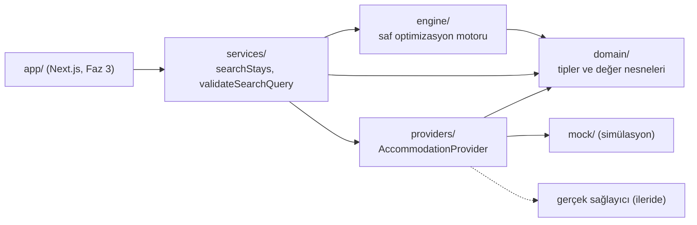

# StaySplit — Mimari ve Algoritma

Bu belge, StaySplit'in nasıl çalıştığını ve kararların **neden** böyle verildiğini anlatır. Kod tarafında
tanımlayıcılar ve yorumlar İngilizce, kullanıcıya gösterilen metinler Türkçedir.

## 1. Katmanlar



| Klasör | Sorumluluk | Neye bağımlı |
| --- | --- | --- |
| `src/domain` | `Money`, `IsoDate`, `Property`, `StayQuote`, `SearchQuery`, `StayPlan`, şehir kataloğu | yalnızca date-fns |
| `src/engine` | Teklif tablosu, optimizasyon (DP), öneri kuralları, plan doğrulama | domain |
| `src/providers` | Sağlayıcı arayüzü, registry, mock sağlayıcı ve demo verisi | domain |
| `src/services` | Arama akışı (orkestrasyon) ve girdi doğrulama | hepsi |
| `src/app` | Next.js sayfaları (Faz 3) | services |
| `src/test` | Test yardımcıları (`makeQuote`, `InMemoryProvider`) | — |
| `scripts` | `npm run demo` terminal demosu | services |

**Kural:** Motor ağ, veritabanı ya da React bilmez. Girdi alır, çıktı verir. Bu yüzden milisaniyeler içinde
test edilir ve ileride bir worker'a ya da ayrı bir servise taşınabilir.

## 2. Veri modeli: üç kritik karar

**Para tam sayıdır (kuruş).** `0.1 + 0.2 !== 0.3`. Kayan noktalı sayılarla yüzlerce teklif toplanınca kuruş
farkları birikir. `Money.amount` her zaman kuruş cinsinden bir tam sayıdır. TL'ye yalnızca sınırlarda
(form, ekran) çevrilir.

**Tarih bir an değil, takvim günüdür.** "20 Ocak gecesi" İstanbul'daki misafir için de Virginia'daki sunucu
için de aynı gecedir. JS `Date` ise bir *andır*. Saat dilimi dönüşümleri gece kaymalarına yol açar. Bu yüzden
tarihler `"2027-01-20"` biçiminde `IsoDate` (branded string) olarak taşınır. Testler bilerek yaz saati
uygulaması olan bir dilimde (`America/New_York`) koşar.

**Fiyat, aralığın toplam teklifidir.** `StayQuote.total`, sağlayıcının *tam o giriş-çıkış çifti* için verdiği
fiyattır. Gecelik fiyatların toplamı değildir:

- 3+ gece %5 indirim → fiyat(20→23) < fiyat(20→21) + fiyat(21→23)
- Konaklama başına temizlik ücreti → iki kısa konaklama bu ücreti iki kez öder
- Yüzdesel vergiler, sabit ücretler, paket fiyatlar…

Motor yalnızca `total`'ı okur. `breakdown` sadece gösterim içindir. Gerçek API'ler de (ör. Booking.com
Demand API) belirli tarih çiftleri için toplam fiyat döndürür. Mimari buna göre kuruldu.

## 3. Arama akışı (`searchStays`)

1. **Aday tesisler:** `provider.searchProperties(şehir, kişi sayısı, türler)`
2. **Gerekli aralıklar:** `requiredRanges(N, K, m)`. Yalnızca geçerli bir planda yer alabilecek aralıklar istenir.
3. **Teklifler:** `provider.getQuotes(tesisler × aralıklar)`
4. **Teklif tablosu:** `QuoteTable` teklifleri doğrular (para birimi, kişi sayısı, tarih penceresi, fiyat),
   bozukları reddedip raporlar ve c(p, i, j) maliyetine O(1) erişim sağlar.
5. **Optimizasyon:** `optimizeStay` her otel değişikliği sayısı için en iyi k planı ve toplam geçerli plan
   sayısını bulur.
6. **Öneri:** `recommend` iş kurallarını uygular ve bir gerekçe kodu üretir.
7. **Sunum:** `toStayPlan` indeksleri tarihlere, tesislere ve transfer bacaklarına çevirir.
   `findPlanViolations` her çıktıyı yeniden doğrular (savunma derinliği).

## 4. Optimizasyon algoritması

### Model

Sınırlar 0 … N seyahatin tarihleridir (0 = giriş, N = çıkış). Gece t, [t, t+1) aralığıdır. Bir plan şöyle
bir segment dizisidir:

```
[b₀=0, b₁) tesis p₁,  [b₁, b₂) tesis p₂,  …,  [b_s, b_{s+1}=N) tesis p_{s+1}
```

Kısıtlar ve nasıl sağlandıkları:

| Gereksinim | Nasıl sağlanıyor |
| --- | --- |
| Tüm geceler eksiksiz | b₀ = 0, b_{s+1} = N |
| Boşluk/çakışma yok | Yarı açık aralıklar ve kesin artan b: bir segmentin çıkışı = sonrakinin girişi |
| Gerçek müsaitlik | Teklif yoksa aralık rezerve edilemez (c = ∞) |
| Minimum konaklama | Tesis kuralı → sağlayıcı teklif vermez. Kullanıcı tercihi → `minNightsPerSegment` |
| Maksimum değişiklik | s ≤ K |
| Aynı tesise "geçiş" yok | p_t ≠ p_{t+1} |

Maliyet: `Σ c(p_t, b_{t-1}, b_t) + Σ τ(p_t, p_{t+1})`. Burada c teklif toplamı, τ tahmini transfer
maliyetidir.

### DAG üzerinde en kısa yol

Durum (j, p, s) şu anlama gelir: "[0, j) geceleri kapsandı, son segment p'de, s değişiklik kullanıldı."
Her durum yalnızca daha küçük j'li durumlara bağlıdır. Yani durumlar tarihe göre sıralı, yönlü ve döngüsüz bir
graf (DAG) oluşturur, plan da bu grafta bir yoldur. En ucuz plan en kısa yoldur:

```
D(j, p, 0) = c(p, 0, j)
D(j, p, s) = min_{i<j, q≠p}  D(i, q, s−1) + τ(q, p) + c(p, i, j)
Cevap      = min_{p, s≤K}    D(N, p, s)
```

**Optimal alt yapı:** (i, q, s) durumundan sonrası, oraya nasıl gelindiğinden bağımsızdır. Bu yüzden her
durum için en iyi öneki saklamak yeterlidir.

### Tek çözüm yerine en iyi k çözüm

Arayüz alternatifleri de gösterdiği için her durum en iyi **k** öneki tutar. Bu yaklaşım hâlâ kesindir.
Global en iyi k içindeki bir planın öneki, kendi durumunda en iyi k içinde olmak zorundadır. Aksi halde orada
k tane daha ucuz önek olurdu. Her birine aynı sonek eklenince k tane daha iyi plan çıkardı, bu da çelişkidir.
Eşitlikler sabit bir **tam sıralama** ile bozulur: (toplam maliyet, değişiklik sayısı, segment tarihleri,
tesis). Böylece argüman geçerli kalır ve çıktı deterministik olur.

Aynı döngüde bir **sayma DP'si** de çalışır: `count(j,p,s) = Σ count(i,q,s−1)`. Bu, toplam geçerli plan
sayısını (`validCombinations`) verir. Hem istatistik olarak işe yarar hem de brute-force ile karşılaştırılabilir.

### Karmaşıklık

- Zaman: **O(K · N² · P² · k)**. 14 gece, 50 tesis, K = 1, k = 10 için yaklaşık 5 milyon basit adım (ms
  mertebesi).
- Kaba kuvvet K = 1 için benzerdir ama P^(K+1) ile büyür. DP formu K ≥ 2 olduğunda önem kazanır.
- **Sağlayıcı istek sayısı** gerçek API'lerde asıl darboğazdır. Bir aralık ancak kalan parçaları
  (önce/sonra) boş ya da ≥ m gece ise ve her boş olmayan parça bir değişiklik gerektiriyorsa istenir:

| K | İstenen aralık sayısı (m = 1) |
| --- | --- |
| 0 | 1 (yalnızca tam konaklama) |
| 1 | 2N − 1 (tam + önekler + sonekler) |
| ≥ 2 | N(N+1)/2 |

MVP'nin K ≤ 1 ile sınırlı olmasının bir nedeni de budur: istek sayısı doğrusal kalır.

## 5. Öneri kuralları (`recommend`)

Optimizer "her değişiklik sayısı için en ucuzu ne?" sorusunu cevaplar. Öneri katmanı ise "misafire ne
söyleyelim?" sorusunu. Az değişiklikten çoğa doğru ilerlenir. Daha fazla değişiklik içeren bir plan ancak
**kesinlikle daha ucuzsa** ve tasarruf politika eşiğini geçiyorsa seçilir. Varsayılan eşik %5'tir
(`DEFAULT_RECOMMENDATION_POLICY`), çünkü otel değiştirmenin bir zahmeti vardır: bavul, 11:00 çıkış ile 14:00
giriş arasındaki boşluk. Eşit fiyatta daha az değişiklik kazanır.

| Gerekçe | Anlamı |
| --- | --- |
| `split-saves-money` | Bölmek eşiği aşan tasarruf sağlıyor |
| `no-single-available` | Hiçbir tesis tüm gecelerde müsait değil |
| `single-only-requested` | Kullanıcı K = 0 seçti |
| `no-split-available` | Geçerli bölünmüş plan yok |
| `tie-prefers-fewer-switches` | Fiyat eşit, tek otel önerildi |
| `savings-below-threshold` | Bölmek ucuz ama değmez |
| `transfer-cost-cancels-savings` | Konaklamada ucuz ama transfer tasarrufu siliyor (ayrıca hesaplanan transfersiz geçişle tespit edilir) |
| `single-is-cheapest` | Tüm bölünmüş planlar transfer olmadan da pahalı |

**Bütçe** öneriyi ve alternatifleri filtreler. En iyi tek otel ise bütçeyi aşsa bile referans fiyat
olarak döner (`withinBudget: false`). Böylece "bütçeni aşan 4.500 TL'lik otel yerine 2.700 TL" diyebiliriz.

## 6. Mock sağlayıcı

- 3 şehirde (İstanbul, Kahire, Roma) 29 **hayali** tesis var. Koordinatlar gerçek semtlere ait, böylece
  mesafe ve transfer tahminleri gerçekçi oluyor. İsimler ve fiyatlar uydurma.
- Fiyat = baz × sezon × hafta sonu × talep gürültüsü. Bunun üzerine kişi başı/oda başı fiyatlandırma, uzun
  konaklama indirimi, temizlik ücreti, şehre özgü vergiler (İstanbul %2 konaklama vergisi, Kahire servis +
  KDV, Roma kişi başı şehir vergisi) eklenir. Vergi oranları gösterim amaçlıdır, güncel yasal oranlar değildir.
- Müsaitlik ve talep, `(tesis, tarih, amaç)` anahtarının hash'inden üretilir. Aynı arama her zaman aynı
  sonucu verir: testler kararlı kalır, hatalar yeniden üretilebilir.
- `bookingUrl` her zaman `null`, `info.isDemo` her zaman `true`. Arayüz bunu her fiyatın yanında belirtmek
  zorundadır.

## 7. Gerçek sağlayıcı eklemek

1. `src/providers/<ad>/` altında `AccommodationProvider`'ı uygulayan bir sınıf yazın.
2. Sağlayıcının yanıtını domain tiplerine çevirin. Rezerve edilemeyen aralıklar için teklif döndürmeyin.
   `total` o aralığın gerçek toplam fiyatı olmalı.
3. Hataları `ProviderError` ile sarın (`retryable` ile zaman aşımı ve rate limit'i ayırın). `AbortSignal`'ı
   iletin.
4. `src/providers/registry.ts`'e bir `case` ekleyin. Anahtarları yalnızca ortam değişkenlerinden okuyun.
5. `searchStays` ve motor değişmez.

Kurallar: uydurma API anahtarı yok, izinsiz scraping yok, sağlayıcı verisini gerçekmiş gibi gösterme yok,
çalışmayan rezervasyon bağlantısı yok.

## 8. Test stratejisi

```
npm test          # 72 test, ~1 sn
```

| Gereksinim | Test |
| --- | --- |
| Tek otel daha ucuz | `search-stays.test.ts` → *recommends the single property when it is cheaper* |
| İki otel daha ucuz | *recommends splitting when two properties are cheaper* (2.700 TL, %40) |
| Tüm bölünme tarihleri | *considers every split date* |
| Bazı geceler müsait değil | *works around nights on which a property is sold out* |
| Hiç kombinasyon yok | *explains when no combination covers every night* |
| Minimum gece | *respects a minimum number of nights per stay* ve *…property's own minimum-stay rule* |
| Transfer tasarrufu siliyor | *drops the split when the transfer cost cancels the saving* |
| Boşluk/çakışma yok | *never produces gaps or overlaps between stays* (3 şehir × 4 tarih × transfer açık/kapalı) |
| Toplam teklif fiyatı | `mock-provider.test.ts` → *prices a stay as a whole, not as a sum of nights* |

**Diferansiyel test:** `optimizer.test.ts` 400 rastgele küçük örnekte DP'nin çıktısını, tüm planları tek tek
deneyen kaba kuvvet algoritmasıyla birebir karşılaştırır: sıralama, değişiklik sayısına göre listeler ve plan
sayısı. Fiyatlar bilerek dar bir aralıktan seçilir ki eşitlikler sık olsun ve eşitlik bozma kuralları da
sınansın. Optimize edilmiş bir algoritmayı, yavaş ama açıkça doğru bir referansla sınamak üretimde en güvenilir
alışkanlıklardan biridir.

## 9. Bilinen sınırlamalar ve sonraki adımlar

- **Yalnızca TRY.** Çoklu para birimi için kur servisi ve para birimi seçici gerekir.
- **K ≤ 1.** Motor her K'yi destekler. Sınır, istek sayısı ve arayüz sadeliği için konuldu.
- **Farklı türleri kıyaslama.** "En iyi tek otel" tür filtresi yoksa hostel ile oteli karşılaştırabilir. İleride
  tasarrufu benzer kalite/tür içinde ölçmek düşünülmeli.
- **Ölçek.** P büyüdüğünde (yüzlerce tesis) P² terimi için aday ön eleme (fiyat/puan ile ilk M tesis) ve
  teklif önbelleği (kısa TTL) eklenmeli.
- **Sunucu sınırı.** Gerçek sağlayıcı anahtarlarla geldiğinde sağlayıcı modülleri `server-only` ile korunmalı.
- **Fiyat tazeliği.** `retrievedAt` saklanıyor. Rezervasyona yönlendirmeden önce fiyat yeniden doğrulanmalı.

## 10. Yol haritası

| Faz | Kapsam | Durum |
| --- | --- | --- |
| 1 — Foundation | Mimari, klasörler, kurulum, tipler | ✅ |
| 2 — Optimization Engine | Mock veri, müsaitlik, fiyat, DP, testler, demo | ✅ |
| 3 — Frontend | Arama formu, sonuçlar, zaman çizelgesi, responsive, loading/boş durumlar | ⏳ |
| 4 — Integration Readiness | Route handler/API, hata yönetimi, `server-only`, önbellek, dokümantasyon | ⏳ |
